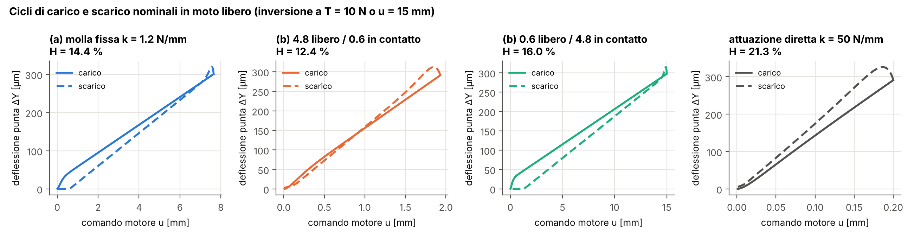
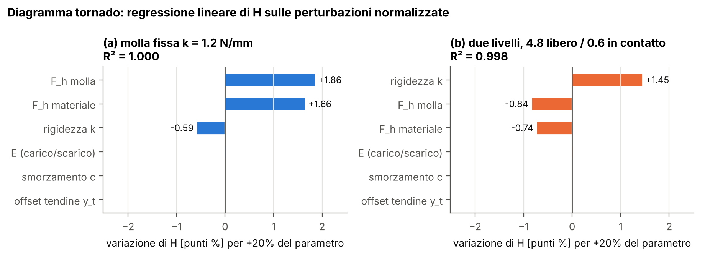
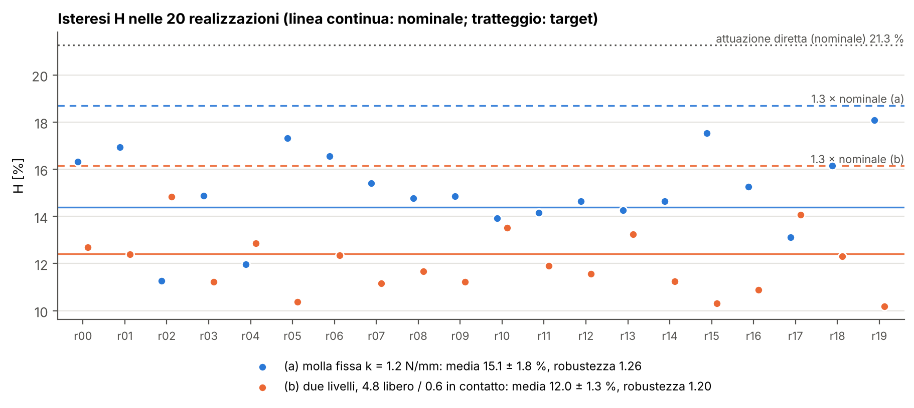
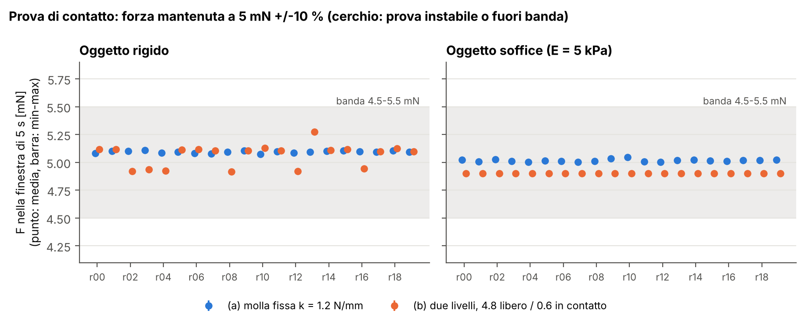

# Progetto 5: incertezza parametrica, Monte Carlo e analisi di sensibilità

Progetto di Robotica Medica, A.A. 2026/27, Vestri Giulio P38000317

Il progetto simula in SOFA un tubo in nitinol che viene piegato da un tendine, con una molla in
serie tra il motore e il tendine. L'obiettivo è capire quanto l'isteresi del sistema e la
stabilità del contatto con un oggetto risentono dell'incertezza sui parametri, e quali parametri
pesano di più.

Si confrontano due molle:

- (a) molla fissa con k = 1.2 N/mm;
- (b) molla a due livelli, 4.8 N/mm in moto libero e 0.6 N/mm in contatto. Il cambio avviene
  appena la forza di contatto raggiunge 5 mN.

Per ciascuna si simulano il caso nominale e 20 realizzazioni con parametri perturbati a caso. Da
queste si ricavano media, deviazione standard e caso peggiore dell'isteresi H, il numero di
contatti instabili e un diagramma tornado che ordina i parametri per influenza.

Ambiente: Ubuntu 22.04, SOFA v26.06 (binario per Python 3.12, con SofaPython3 e SoftRobots).

## Il modello

```
motore (u) ──[ molla: k, c, isteresi ]── tendine (u1) ──► tubo in nitinol ──► oggetto
```

Il tubo ha diametro esterno 1.93 mm, spessore 0.22 mm e lunghezza 100 mm. I primi 40 mm
(l'albero) sono bloccati, gli ultimi 60 si flettono. La meccanica usa `TetrahedronFEMForceField`
su una mesh di tetraedri con 3720 nodi, più fitta nella parte flessibile (passo assiale 0.4 mm).
Il modulo di Young vale 77 GPa in carico e 65 GPa in scarico, e il controller lo cambia quando il
motore inverte il verso. I modelli visivo e di collisione sono superfici OBJ collegate alla mesh
con `BarycentricMapping`; quella di collisione copre solo il tratto finale, vicino all'oggetto.

Il tendine è un `CableConstraint` comandato in forza, a 0.6 mm dall'asse del tubo e ancorato alla
punta.

La molla trasmette al tendine una tensione che dipende dal suo allungamento ΔLs = u − u1, dove u
è la posizione del motore e u1 lo spostamento del tendine:

```
T = max(0,  k·ΔLs  +  z·(Fh_molla + Fh_mat)  −  c·du1/dt)
```

z è lo stato di un modello di isteresi di Dahl: varia tra −1 e +1 e cambia segno quando il motore
inverte (σ0 = 10 mm⁻¹). L'isteresi della molla (0.45 N) e quella del materiale (0.40 N) sono
sommate in un unico termine da ±0.85 N. Lo smorzamento c = 1.5 N·s/mm agisce sulla velocità del
tendine.

L'oggetto di contatto è un cubo di 20 mm affacciato alla punta, a 0.03 mm di distanza. Può essere
rigido oppure soffice (E = 5 kPa, ν = 0.45, mesh di esaedri più fitta vicino al contatto). Il
contatto usa `FrictionContactConstraint` con μ = 0.2.

Il contatto viene riconosciuto quando la forza supera 5 mN e si considera perso quando scende
sotto 0.1 mN. Per tutta la sua durata la molla (b) resta a 0.6 N/mm e un regolatore muove il
motore per tenere la forza a 5 mN ± 10 % (4.5–5.5 mN). Il regolatore interviene quando l'errore
supera 0.3 mN e ferma il motore quando torna sotto 0.1 mN.

## Prove e metriche

Nel ciclo libero, senza oggetto, il motore carica a 1 mm/s finché la tensione arriva a 10 N (o u
a 15 mm) e poi torna a zero. L'isteresi è la massima differenza di deflessione della punta tra
carico e scarico a pari u, in percentuale della deflessione massima:

```
H = max |ΔY_carico(u) − ΔY_scarico(u)| / ΔY_max · 100 %
```

Il riferimento è l'attuazione diretta, cioè una molla con k = 50 N/mm (con gli stessi valori di
isteresi e smorzamento), caricata a 0.1 mm/s.

Nella prova di contatto, su oggetto rigido e soffice, il motore avvicina la punta a 2 mm/s. Dopo
il rilevamento il regolatore porta la forza nella banda; si attende 1 s a motore fermo e poi si
osserva una finestra di 5 s. Il contatto è stabile se nella finestra l'oscillazione picco-picco
della forza resta sotto il 30 % della media e il contatto non si perde.

Il Monte Carlo perturba sei parametri: E (carico e scarico insieme), Fh_mat, Fh_molla, c, k (la
molla fissa o i due livelli insieme) e y_t. In ogni realizzazione ciascuno viene moltiplicato per
1 + δ, con |δ| uniforme tra 10 % e 20 % e segno casuale (seed 2026). Le stesse 20 realizzazioni
valgono per le due molle, e né la soglia . In tutto sono 127
simulazioni: (1 nominale + 20) × 2 molle × 3 prove, più l'attuazione diretta.

Il tornado viene da una regressione lineare di H sulle perturbazioni normalizzate x = δ / 20 %.
Ogni coefficiente indica di quanti punti percentuali cambia H per una perturbazione di +20 % del
parametro.

## Risultati

### Caso nominale

| Molla | H | H / H diretta |
|---|---:|---:|
| (b) 4.8 libero / 0.6 in contatto | 12.4 % | 0.58 |
| (a) fissa 1.2 N/mm | 14.4 % | 0.68 |
| (b) ordine inverso, 0.6 libero / 4.8 in contatto | 16.0 % | 0.75 |
| attuazione diretta 50 N/mm | 21.3 % | 1 |

Per la molla (b) è stato scelto l'ordine 4.8 → 0.6. Oltre a dare la H più bassa, al rilevamento
la forza scende invece di salire. Con l'ordine inverso la tensione passa di colpo da circa 5 a
35 N e sul soffice la forza arriva a 43 mN.



### Monte Carlo

| | (a) fissa | (b) due livelli |
|---|---:|---:|
| H nominale | 14.39 % | 12.42 % |
| H media ± dev. std | 15.10 ± 1.78 % | 12.00 ± 1.27 % |
| H caso peggiore | 18.09 % (r19) | 14.84 % (r02) |
| indice di robustezza (peggiore / nominale) | 1.26 | 1.20 |
| contatti instabili (rigido + soffice) | 0 su 40 | 0 su 40 |
| parametri dominanti | Fh_molla, Fh_mat | k, Fh_molla |

La configurazione più robusta è la (b): ha l'indice di robustezza più basso e H minore sia in
media sia nel caso peggiore. Rispetta il target (caso peggiore entro 1.3 volte il nominale,
contatto stabile in tutte le 20 realizzazioni), che peraltro è rispettato anche dalla (a).



Nella molla fissa H cresce con l'isteresi: +1.86 punti per Fh_molla, +1.66 per Fh_mat, −0.59 per
k. Nel modello le due isteresi formano un unico termine, quindi i loro coefficienti stanno nello
stesso rapporto dei valori nominali (0.45 / 0.40). In pratica il parametro che conta è l'ampiezza
totale dell'isteresi.

Nella molla a due livelli domina k (+1.45), mentre le isteresi hanno segno negativo (−0.84 e
−0.74). Con la molla rigida in moto libero, l'isteresi di Dahl e la differenza tra E di carico e
di scarico spostano il ramo di scarico in versi opposti e in parte si compensano. E, c e y_t non
hanno un effetto misurabile in nessuna delle due molle (coefficienti sotto 0.03 punti). La
regressione spiega quasi tutta la variabilità (R² = 0.9998 per la (a), 0.998 per la (b)).



In tutte le 84 prove di contatto, nominali comprese, la forza nella finestra resta tra 4.90 e
5.30 mN, l'oscillazione picco-picco è sotto lo 0.6 % della media e il contatto non si perde mai.
Il transitorio subito dopo il rilevamento è misurato a parte. Sul rigido il picco di forza arriva
a circa 11 mN con la molla fissa e 16 mN con quella a due livelli; sul soffice resta intorno a
5 mN. Con la molla (b) sul soffice la regolazione dura fino a 7.7 s, perché a 0.6 N/mm il motore
deve fare molta più corsa per recuperare la tensione.



## Struttura del repository

```
main_scene.py            scena SOFA (createScene)
run_gui.sh               avvio della GUI con le opzioni --object, --spring, --kfree
env.sh                   variabili d'ambiente per gli script python3.12
modules/
  config.py              parametri nominali, configurazioni della molla, parametri incerti
  geometry_gen.py        mesh del tubo e dell'oggetto (OBJ e VTK)
  spring_model.py        molla in serie con isteresi di Dahl e smorzamento
  contact_control.py     rilevamento del contatto e regolatore di forza
  controller.py          controller da tastiera e ciclo autonomo
  contact_force.py       lettura della forza di contatto dal constraint solver
  metrics.py             calcolo di H e della stabilità del contatto
  protocols.py           ciclo libero e prova di contatto
  monte_carlo.py         campionamento, regressione, statistiche
  mc_worker.py           esecuzione di un singolo caso del Monte Carlo
  live_plot.py           grafici in tempo reale e registrazione CSV (solo GUI)
  amplified_view.py      deformazione ingrandita (solo GUI)
tools/
  generate_meshes.py     genera le mesh in meshes/
  mesh_convergence.py    confronto con la teoria della trave al variare della mesh
  run_cycle.py           casi nominali
  run_monte_carlo.py     campagna Monte Carlo
  make_figures.py        figure dei risultati
  live_plot_viewer.py    finestra dei grafici in tempo reale
meshes/                  mesh nominali
results/
  nominali/              metriche dei casi nominali
  mc_finale/             realizzazioni, risultati dei 127 casi e riepilogo
  figures/               figure
```

## Come eseguire

Servono SOFA v26.06 per Python 3.12 (con SoftRobots) e, per i grafici, il Python di sistema con
matplotlib. Il progetto va messo nella cartella `SOFA_Project` accanto a quella di SOFA:

```bash
sudo apt install python3-matplotlib python3-tk
cd ~/SOFA_v26.06.00_Linux_Python3.12
git clone https://github.com/GV-ing/RoboticaMedica_fp.git SOFA_Project
cd SOFA_Project
chmod +x run_gui.sh
source env.sh        # da ripetere in ogni nuovo terminale
```

`env.sh` e `run_gui.sh` si aspettano SOFA in
`~/SOFA_v26.06.00_Linux_Python3.12/SOFA_v26.06.00_Linux`.

### Simulazione interattiva

```bash
./run_gui.sh                                   # oggetto soffice, molla fissa
./run_gui.sh --object rigid --spring switched  # oggetto rigido, molla a due livelli
./run_gui.sh --object none --spring direct     # moto libero, attuazione diretta
```

Le opzioni sono `--object soft|rigid|none`, `--spring fixed|switched|direct` e `--kfree high|low`
(ordine dei livelli della molla b). Dopo l'avvio si preme Play. In runSofa i tasti arrivano alla
scena solo tenendo premuto Ctrl:

| Tasto | Azione |
|---|---|
| Ctrl + ↑ (oppure Ctrl + U) | carico: u + 0.35 mm |
| Ctrl + ↓ (oppure Ctrl + D) | scarico: u − 0.35 mm |
| Ctrl + R | reset |
| Ctrl + M | passaggio tra comando manuale e ciclo autonomo |

Quando la punta è in contatto la forza è regolata e il carico manuale viene ignorato: la freccia
giù sospende la regolazione e la freccia su la riattiva. A ogni comando il terminale stampa u, T,
ΔLs, la posizione della punta e la forza di contatto.

Insieme a SOFA si apre una finestra con i grafici in tempo reale: a sinistra i cicli T–ΔLs della
molla e ΔY–u della punta, con H calcolata durante la prova; a destra, nel tempo, posizione della
punta, u e ΔLs, tensione, forza di contatto e rigidezza k. Ogni passo viene salvato in
`results/gui_<data>.csv`.

Per tenere la GUI fluida la scena usa mesh più leggere (passo 0.8 mm sul tubo) e componenti
paralleli, mentre dt e solver restano quelli delle prove. Con `gui_fast = False` in `config.py`
si usa il modello completo; con `visual_amplification` si può mostrare la deformazione
ingrandita, lasciando la forma reale in trasparenza.

### Prove automatiche

```bash
python3.12 tools/generate_meshes.py                          # mesh in meshes/ (pochi secondi)
python3.12 -u tools/run_cycle.py --free --contact            # casi nominali (circa 1 ora)
python3.12 -u tools/run_monte_carlo.py --outdir results/mc_nuovo          # circa 5.5 ore
env -u PYTHONPATH python3 tools/make_figures.py --campaign results/mc_nuovo
```

Il Monte Carlo gira su 3 processi (si cambiano con `--workers`) e salva ogni caso appena finisce:
se si interrompe, si riprende rilanciando lo stesso comando con `--resume`. Le figure non
richiedono SOFA. Le serie temporali in CSV non sono nel repository e vengono rigenerate dagli
script.

La scena rigenera comunque le sue mesh a ogni avvio, in una cartella di lavoro comune: meglio non
aprire la GUI mentre girano gli script.


## Note su SOFA

- Unità della scena: mm, N, s e MPa, quindi le masse sono in tonnellate.
- Con `FreeMotionAnimationLoop` il valore del `CableConstraint` è un impulso, quindi si impone
  T·dt.
- La forza di contatto si legge dalle `constraintForces` del `BlockGaussSeidelConstraintSolver`,
  divise per dt ed escludendo la riga del cavo. Il `lambda` dei modelli di collisione mappati la
  conterebbe due volte.
